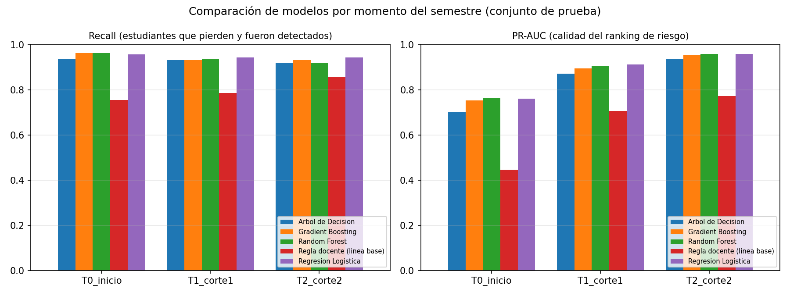

# Estado del proyecto y evidencias

**Actualizado:** 17 de noviembre de 2026 · **Código:** [commit `3479349`](https://github.com/Teorxn/Alertas-tempranas/commit/3479349923e29c5287eeaf07a4a2ba1d7fbf3475)

> **Estado del prototipo.** Este repositorio documenta un trabajo de investigación en curso,
> no un sistema en producción.
>
> - **Base de datos:** aún no contamos con la base de datos real. Hoy se usa una base SQLite
>   local poblada con datos sintéticos (700 estudiantes, 2 800 inscripciones, 6 docentes de
>   demostración) únicamente para probar el flujo de extremo a extremo.
> - **Modelos:** sí hay modelos entrenados y evaluados para tres momentos del semestre
>   (T0 inicio, T1 corte 1, T2 corte 2), con métricas, matrices de confusión y análisis de
>   equidad versionados en [`evidencias/`](evidencias/).
> - **Prototipo:** API y interfaz funcionando con acceso por docente, explicación individual
>   de cada alerta y centro de notificaciones.
> - **Alcance:** las cifras son preliminares y provienen de datos inventados; no describen el
>   desempeño real ni deben usarse para decisiones sobre estudiantes. El docente siempre
>   decide la intervención.

Esta página es el índice. El detalle está en [EVIDENCIAS.md](EVIDENCIAS.md),
[DECISIONES.md](DECISIONES.md) y [AVANCE.md](AVANCE.md).

---

## 1. Qué se construyó

| Capa | Qué hace | Código | Evidencia |
|---|---|---|---|
| Datos sintéticos | Genera 700 estudiantes y 2 800 inscripciones con `docente_id` y `curso` | [`src/generar_datos_sinteticos.py`](../src/generar_datos_sinteticos.py) | [`resumen.json`](evidencias/resumen.json) |
| Variables por momento | Define qué información existe en T0, T1 y T2 (sin fuga del futuro) | [`src/config.py`](../src/config.py), [`src/features.py`](../src/features.py) | [Decisión 2](DECISIONES.md) |
| Modelos | Compara regla docente, regresión logística, árbol, Random Forest y Gradient Boosting | [`src/entrenar.py`](../src/entrenar.py) | [`metricas.csv`](evidencias/metricas.csv) |
| Explicación | Oclusión: qué variable cambia la predicción y qué acción sugiere | [`src/explicar.py`](../src/explicar.py) | Figuras de importancia |
| Auditoría | Equidad por género, estrato y jornada | [`src/entrenar.py`](../src/entrenar.py) | [`equidad.csv`](evidencias/equidad.csv) |
| Prototipo clásico | Dashboard Streamlit con semáforo | [`app/dashboard.py`](../app/dashboard.py) | Informe técnico |
| API segura | Login, sesiones, CSRF, aislamiento por docente, notificaciones | [`backend/`](../backend/) | [`tests/test_api.py`](../tests/test_api.py) |
| Resúmenes | Gemini (Interactions API) con OpenAI y plantilla como respaldos | [`backend/services/llm.py`](../backend/services/llm.py) | Verificación §5 |
| Interfaz | Next.js sobria: filtros, ficha, notificaciones, sin emojis | [`frontend/`](../frontend/) | Verificación §5 |

## 2. Avances por fase

### Fase 1 — Prototipo de investigación

1. Definición del problema: **pérdida de asignatura** (nota definitiva < 3.0), no deserción.
2. Revisión de literatura y patentes; documentos en [`investigacion/`](investigacion/).
3. Datos sintéticos generados con semilla fija (`SEMILLA = 42`).
4. Tres instantes de predicción: **T0** (solo historial), **T1** (tras corte 1), **T2** (tras corte 2).
5. Cinco estrategias comparadas contra la regla del docente; validación 80/20 por estudiante y
   validación cruzada agrupada de 5 pliegues.
6. Selección por PR-AUC y umbral por F2, priorizando recall.
7. Modelos serializados: `T0_inicio.joblib`, `T1_corte1.joblib`, `T2_corte2.joblib`.
8. Dashboard Streamlit con semáforo, explicación y auditoría de equidad.
9. Informe técnico del semillero (PDF).

### Fase 2 — Módulo web para docentes

1. API FastAPI con contraseñas bcrypt, sesiones opacas, CSRF, límite de intentos y cabeceras
   de seguridad.
2. Aislamiento real en servidor: cada consulta filtra por `docente_id`; una ficha ajena
   devuelve 404.
3. Cálculo de alertas reutilizando los modelos ya entrenados (sin reentrenar en cada petición).
4. Centro de notificaciones: se crean/actualizan al generar alertas y se pueden marcar como
   leídas o atendidas.
5. Resumen del caso con LLM. Solo se envían campos académicos en blanca: nunca nombre, ID,
   correo, género ni estrato. Proveedor principal: **Gemini 3.5 Flash Lite** mediante la
   Interactions API, con `store=false` para que el proveedor no conserve el caso. Respaldo:
   OpenAI y, si falla o se agota el presupuesto, plantilla local.
6. Interfaz Next.js sobria e institucional, sin emojis ni lenguaje de «IA».
7. Pruebas automáticas y verificación end-to-end.

## 3. Resultados preliminares (datos sintéticos)

| Momento | Mejor modelo | Recall | Precisión | PR-AUC | % alertado | Regla docente (recall / PR-AUC) |
|---|---|---:|---:|---:|---:|---:|
| T0 inicio | Regresión logística | 0.956 | 0.413 | 0.762 | 65.7% | 0.755 / 0.447 |
| T1 corte 1 | Regresión logística | 0.943 | 0.676 | 0.912 | 39.6% | 0.786 / 0.707 |
| T2 corte 2 | Random Forest | 0.918 | 0.781 | 0.959 | 33.4% | 0.855 / 0.773 |

Lectura: en T0 se detecta casi todo, pero se alertaría a 2 de cada 3 estudiantes; **T1 es el
punto útil** (94% de detección con suficiente tiempo para intervenir); en T2 mejora la
precisión cuando ya queda poco tiempo. Tabla completa (30 filas, validación y prueba) en
[EVIDENCIAS.md](EVIDENCIAS.md).



## 4. Cómo comprobarlo en 5 minutos

```bash
pip install -r requirements.txt
cd frontend && npm install && cd ..
python src/generar_datos_sinteticos.py
python src/entrenar.py
python -m backend.services.seed
python -m uvicorn backend.main:app --port 8000     # terminal 1
cd frontend && npm run dev                          # terminal 2
```

Abrir **http://localhost:3000**. Cuenta de ejemplo:
`ana.torres@universidad.edu.co` / `ClaveSegura123!` (hay botón para autocompletar).

El botón **Actualizar predicciones** vuelve a puntuar solo los cursos del docente. Para ver
resúmenes redactados por Gemini hace falta definir `GEMINI_API_KEY` en un `.env` local
(ignorado por Git); sin clave se usa la plantilla y el sistema sigue funcionando.

## 5. Verificación ejecutada

| Comprobación | Resultado | Fecha |
|---|---|---|
| `python -m pytest -q tests` | **4 pruebas pasan** | 17 nov 2026 |
| `npx tsc --noEmit` | sin errores | 17 nov 2026 |
| Login, sesión y CSRF | HTTP 200, cookies `HttpOnly` | 17 nov 2026 |
| Dashboard y filtros | HTTP 200, 450 inscripciones visibles para Ana | 17 nov 2026 |
| Ficha individual | HTTP 200, resumen con `fuente=llm` (Gemini) | 17 nov 2026 |
| Notificaciones y marcado | HTTP 200, 721 activas | 17 nov 2026 |
| Interfaces sin emojis | confirmado en HTML renderizado | 17 nov 2026 |

Ejemplo real de resumen generado (caso de riesgo alto, T1):

> **Seguimiento académico en Cálculo I.** El estudiante presenta un desempeño inicial bajo
> en la asignatura, reflejado en la nota del primer corte y en las calificaciones de los
> talleres recientes. *Acción sugerida:* programar una tutoría breve y revisar el caso con
> el docente para definir estrategias de apoyo.

No se envía ningún identificador al proveedor; la predicción la hace siempre el modelo
clásico y el LLM solo redacta.

## 6. Lo que falta

- Conectar con el LMS y usar la base de datos real del profesor.
- Migrar de SQLite a PostgreSQL.
- Repetir la evaluación con datos reales: las cifras actuales no son concluyentes.
- Validar los resúmenes y las acciones sugeridas con docentes.
- Completar el análisis de equidad con datos reales (en sintéticos, el estrato 5 no tiene
  casos de pérdida, así que no hay recall computable para ese grupo).

## 7. Documentación relacionada

- [Evidencias detalladas](EVIDENCIAS.md) — métricas, figuras, procedencia y manifiesto.
- [Decisiones](DECISIONES.md) — por qué se tomó cada camino.
- [Avance completo](AVANCE.md) — metodología CRISP-DM, ética y próximos pasos.
- [README](../README.md) — instalación y seguridad.
- [Informe técnico del semillero](investigacion/EWS_Informe_Tecnico_Semillero.pdf).
