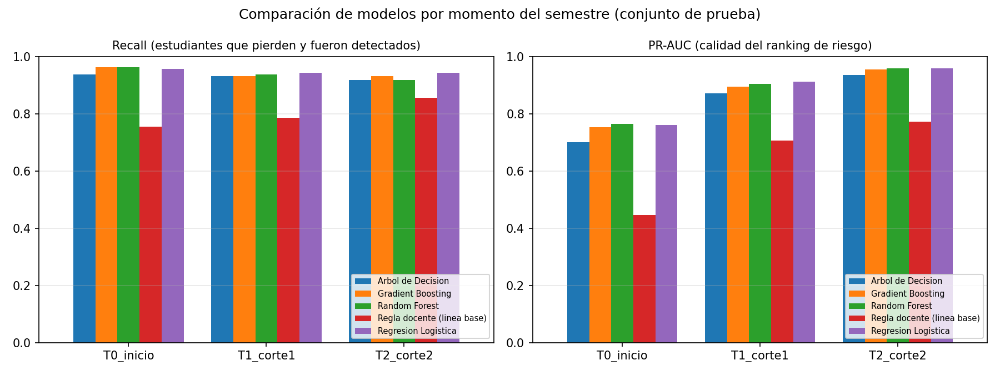
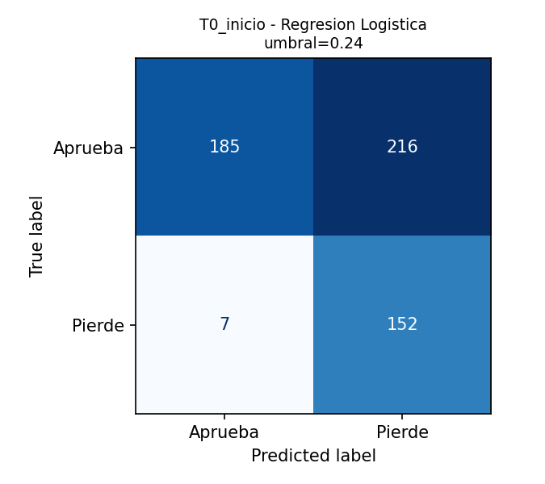
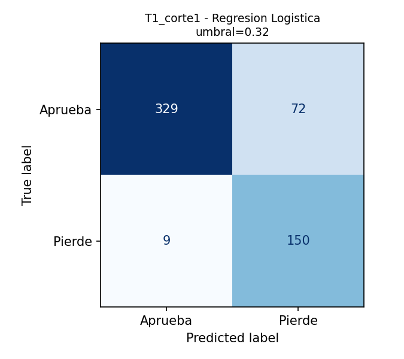
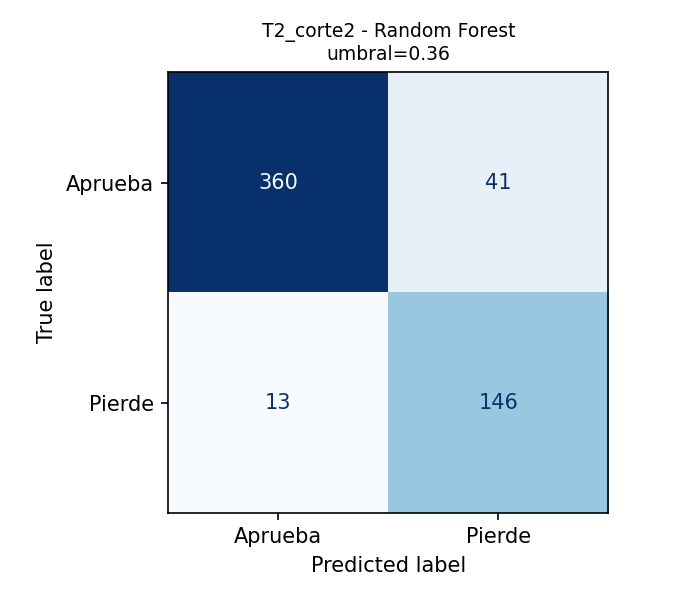
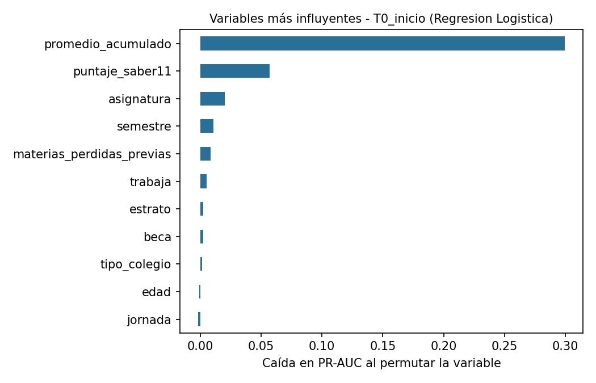
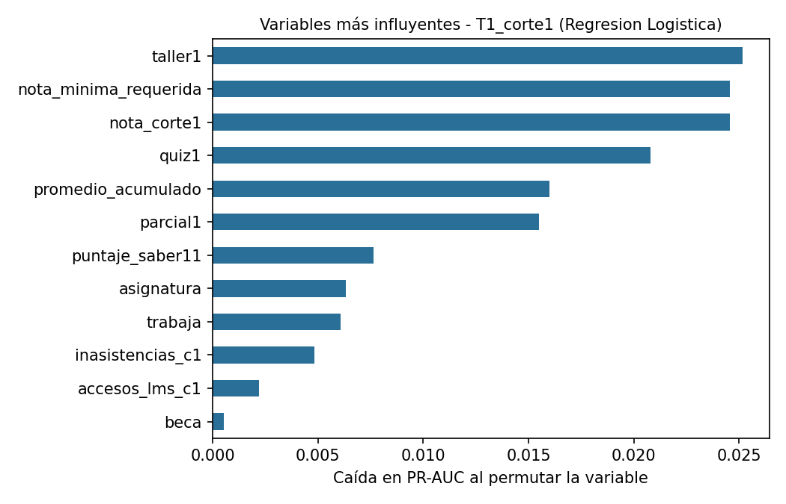
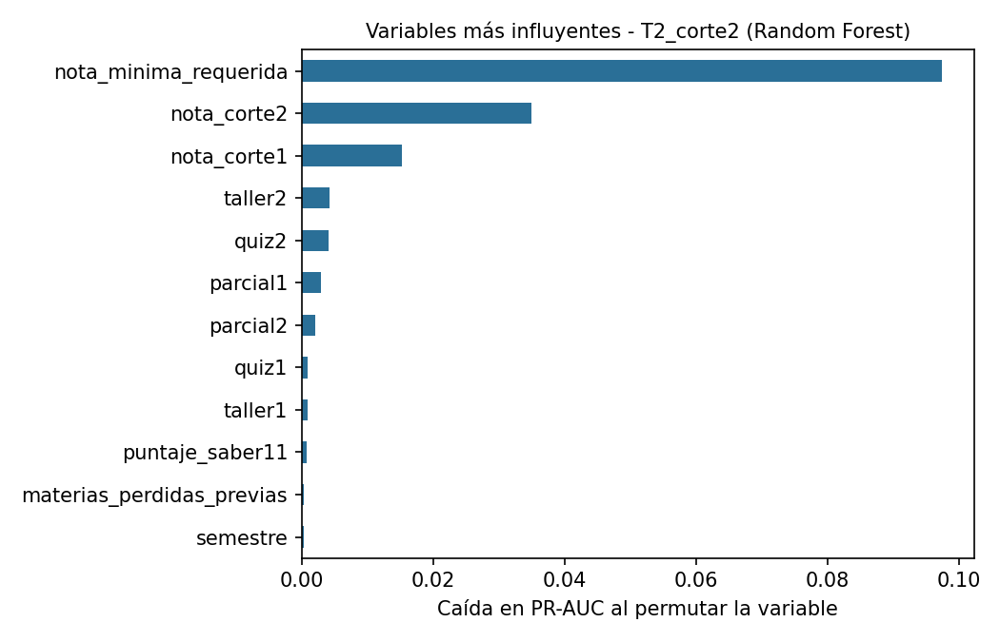

# Evidencias detalladas

Complemento de [ESTADO.md](ESTADO.md). Todos los archivos de esta carpeta están versionados
en `main`; las salidas originales se regeneran con `src/entrenar.py` en `reports/` (ignorado).

## 1. Procedencia de las cifras

| Dato | Valor |
|---|---|
| Código | [commit `3479349`](https://github.com/Teorxn/Alertas-tempranas/commit/3479349923e29c5287eeaf07a4a2ba1d7fbf3475) |
| Generación de datos | `python src/generar_datos_sinteticos.py`, semilla `SEMILLA = 42` |
| Entrenamiento | `python src/entrenar.py` (5 pliegues, semilla 42) |
| Población sintética | 700 estudiantes, 2 800 inscripciones, 27,4% de pérdida |
| Conjunto de prueba | 560 inscripciones de 140 estudiantes no vistos en entrenamiento |
| Partición | `GroupShuffleSplit` 80/20 por estudiante + `StratifiedGroupKFold(5)` |
| Métrica de selección | PR-AUC en validación cruzada; umbral elegido por F2 |
| Identificadores de prueba | [`ids_prueba.csv`](evidencias/ids_prueba.csv) |

> Advertencia: son datos inventados con relaciones casi lineales. Los números demuestran
> que el pipeline funciona; **no son resultados de investigación**.

## 2. Métricas completas (conjunto de prueba)

Las 30 filas —validación cruzada y prueba— están en [`metricas.csv`](evidencias/metricas.csv).
Aquí se reproducen las 15 filas de prueba:

| Momento | Modelo | Umbral | Recall | Precisión | F1 | F2 | ROC-AUC | PR-AUC | % alertado |
|---|---|---:|---:|---:|---:|---:|---:|---:|---:|
| T0 | Regla docente (línea base) | 0.50 | 0.755 | 0.500 | 0.602 | 0.685 | 0.728 | 0.447 | 42,9% |
| T0 | Regresión logística | 0.24 | **0.956** | 0.413 | 0.577 | 0.757 | 0.872 | 0.762 | 65,7% |
| T0 | Árbol de decisión | 0.30 | 0.937 | 0.469 | 0.625 | 0.781 | 0.851 | 0.701 | 56,8% |
| T0 | Random Forest | 0.22 | 0.962 | 0.447 | 0.611 | 0.782 | 0.880 | 0.764 | 61,1% |
| T0 | Gradient Boosting | 0.10 | 0.962 | 0.424 | 0.588 | 0.767 | 0.868 | 0.752 | 64,5% |
| T1 | Regla docente (línea base) | 0.50 | 0.786 | 0.822 | 0.804 | 0.793 | 0.859 | 0.707 | 27,1% |
| T1 | Regresión logística | 0.32 | **0.943** | 0.676 | 0.787 | 0.874 | 0.960 | 0.912 | 39,6% |
| T1 | Árbol de decisión | 0.27 | 0.931 | 0.655 | 0.769 | 0.858 | 0.946 | 0.871 | 40,4% |
| T1 | Random Forest | 0.27 | 0.937 | 0.654 | 0.770 | 0.862 | 0.958 | 0.905 | 40,7% |
| T1 | Gradient Boosting | 0.16 | 0.931 | 0.652 | 0.767 | 0.857 | 0.952 | 0.895 | 40,5% |
| T2 | Regla docente (línea base) | 0.50 | 0.855 | 0.855 | 0.855 | 0.855 | 0.899 | 0.773 | 28,4% |
| T2 | Regresión logística | 0.34 | 0.943 | 0.777 | 0.852 | 0.905 | 0.982 | 0.960 | 34,5% |
| T2 | Árbol de decisión | 0.36 | 0.918 | 0.785 | 0.846 | 0.888 | 0.967 | 0.936 | 33,2% |
| T2 | Random Forest | 0.36 | **0.918** | 0.781 | 0.844 | 0.887 | 0.981 | 0.959 | 33,4% |
| T2 | Gradient Boosting | 0.10 | 0.931 | 0.787 | 0.853 | 0.898 | 0.979 | 0.955 | 33,6% |

Modelos seleccionados y umbrales: [`resumen.json`](evidencias/resumen.json).



### Matrices de confusión

| T0 inicio | T1 corte 1 | T2 corte 2 |
|---|---|---|
|  |  |  |

### Importancia de variables (oclusión)

| T0 inicio | T1 corte 1 | T2 corte 2 |
|---|---|---|
|  |  |  |

## 3. Auditoría de equidad (T1, datos sintéticos)

Fuente completa: [`equidad.csv`](evidencias/equidad.csv).

| Variable | Grupo | n | Tasa real de pérdida | Recall | Falsas alarmas |
|---|---|---:|---:|---:|---:|
| Género | F | 300 | 0,267 | 0,975 | 0,168 |
| Género | M | 260 | 0,304 | 0,911 | 0,193 |
| Estrato | 1 | 56 | 0,429 | 0,958 | 0,219 |
| Estrato | 2 | 232 | 0,366 | 0,965 | 0,265 |
| Estrato | 3 | 140 | 0,129 | 0,778 | 0,123 |
| Estrato | 4 | 112 | 0,286 | 0,969 | 0,138 |
| Estrato | 5 | 20 | 0,000 | — (sin casos) | 0,000 |
| Jornada | Diurna | 504 | 0,280 | 0,943 | 0,179 |
| Jornada | Nocturna | 56 | 0,321 | 0,944 | 0,184 |

Brechas observadas: 6,4 puntos de recall entre géneros y 19,1 entre estratos 2 y 3. Son
cifras de un dataset inventado; sirven para probar que la auditoría se ejecuta, no para
concluir sobre equidad real.

## 4. Artefactos de los modelos

No se versionan los `.joblib` por su tamaño; se regeneran con `src/entrenar.py`.

| Momento | Archivo | Tamaño | Modelo |
|---|---|---:|---|
| T0 inicio | `models/T0_inicio.joblib` | 5,7 KB | Regresión logística |
| T1 corte 1 | `models/T1_corte1.joblib` | 6,6 KB | Regresión logística |
| T2 corte 2 | `models/T2_corte2.joblib` | 3,3 MB | Random Forest |

## 5. Verificación de ejecución

Comandos ejecutados el 17 de noviembre de 2026:

```bash
python -m pytest -q tests
# .... [100%]
# 4 passed, 1 warning in 16.42s

cd frontend && npx tsc --noEmit
# (sin salida: sin errores)
```

Flujo end-to-end contra los servidores locales:

```
health: 200 {"status":"ok"}
login: 200 {"ok":true,"docente":{"id":1,"nombre":"Ana Torres",...}}
cookies: ['ews_csrf', 'ews_session']
me: 200
dashboard: 200 saludo=True notificaciones_ui=True bytes=14011
ui-sin-emojis: True
estudiantes: 200 filas=450
notificaciones: {"activas":721,"no_leidas":720,"pendientes":721}
detalle: 200 fuente=llm  titulo="Seguimiento académico en Cálculo I"
patch notificacion: 200
```

## 6. Manifiesto de esta carpeta

| Archivo | Contenido |
|---|---|
| `resumen.json` | Modelo y umbral elegidos por momento |
| `metricas.csv` | 30 filas: 5 estrategias × 3 momentos × validación/prueba |
| `equidad.csv` | 27 filas: 3 momentos × género/estrato/jornada |
| `ids_prueba.csv` | Identificadores seudonimizados del conjunto de prueba |
| `figuras/*.png` | Comparación, matrices de confusión e importancia de variables |

## 7. Limitaciones concretas de uso

- No usar estas cifras para estimar desempeño real: el proceso generador de datos es conocido
  y favorable a relaciones lineales.
- No usar el sistema para decisiones sobre estudiantes: la predicción es una orientación y
  la intervención la decide el docente.
- No generalizar la auditoría de equidad: hay grupos sin casos de pérdida en los datos
  sintéticos.
- El resumen con LLM puede fallar o agotar el presupuesto (`EWS_LLM_MAX_CALLS`); en ese caso
  se muestra la plantilla y queda etiquetado como tal.
